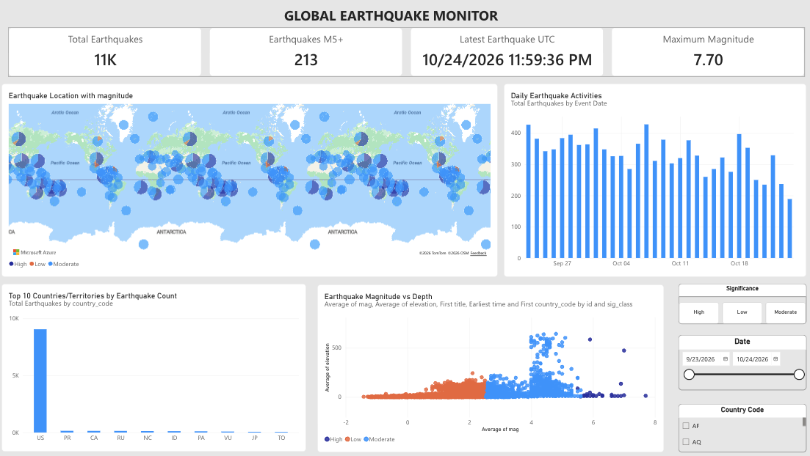
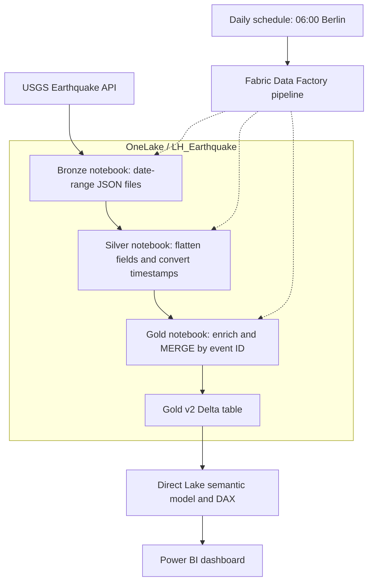

# Global Earthquake Monitor

An automated earthquake data pipeline in Microsoft Fabric, with a Power BI report for exploring earthquake activity by location, event date, magnitude and depth.

**Technology:** Microsoft Fabric, Data Factory, OneLake, Python, Requests, PySpark, Delta Lake, reverse_geocoder, Spark SQL, Direct Lake, Power BI and DAX.

## Dashboard preview

The dashboard shows earthquake locations, daily activity, magnitude and depth, with filters for date, significance and country.

## Project aim

Build a repeatable workflow that retrieves public earthquake records from the USGS API, prepares them for analysis, and presents the results in an interactive dashboard. The project starts with a 30-day historical load and then processes the previous complete UTC day on a daily schedule.

## Analytical use case and business relevance

The report provides an exploratory overview of recorded earthquake activity. It helps a viewer investigate where events occurred, how daily counts change, which events have higher magnitudes, and how magnitude relates to depth.

This is a portfolio implementation of a reporting workflow that could support an operational situation overview. It demonstrates how a public API can feed a scheduled analytics solution with repeatable transformations and data quality checks. It does not predict earthquakes or provide a production emergency alert service. No business cost savings or operational impact have been measured.

## What I built

1. A Bronze notebook that retrieves USGS GeoJSON records and saves JSON files with the requested date range in the filename.
2. A Silver notebook that flattens nested JSON fields, extracts coordinates and converts event timestamps into analysis-ready columns.
3. A Gold notebook that enriches events with country codes, classifies significance and writes data for reporting.
4. A Data Factory pipeline that executes Bronze, Silver and Gold in sequence using notebook date parameters.
5. A daily schedule at 06:00 in the Berlin time zone, with API selection boundaries based on UTC dates.
6. An existing Direct Lake semantic model connected to the new Gold v2 data, supporting the Power BI report.

## Architecture

Solid arrows show the data flow. Dotted arrows show pipeline orchestration. The initial load retrieves 30 days, followed by the previous complete UTC day on each scheduled run.

| Stage | Main processing | Output |
| --- | --- | --- |
| Source | Query the USGS Earthquake API for the requested event-date range | GeoJSON response |
| Bronze | Retrieve and preserve API records | Date-range JSON files in Lakehouse Files |
| Silver | Flatten nested fields and convert epoch milliseconds into timestamps | Silver v2 Delta table |
| Gold | Add country codes and significance classes, deduplicate incoming IDs and merge records | Gold v2 Delta table |
| Semantic model | Connect reporting fields and DAX measures through Direct Lake | Power BI semantic model |
| Report | Apply filters and explore earthquake activity | Interactive dashboard |

## Why I made these design choices

| Decision | Reason |
| --- | --- |
| Bronze, Silver and Gold layers | Separate source ingestion from data preparation and reporting logic. |
| An initial 30-day load | Give the report enough history for daily comparisons before starting incremental ingestion. |
| One complete UTC day per scheduled run | Keep the daily processing window simple and avoid using an incomplete current day. |
| Date ranges in filenames | Make each Bronze batch easier to identify and trace to pipeline parameters. |
| A Delta MERGE keyed by earthquake ID | Avoid adding another copy of an event each time the pipeline encounters the same ID. |
| Event Date in the report model | Group timestamps by calendar day and support date filtering. |
| Separate ingestion dates and report filters | Retain historical data while allowing report viewers to select the period they want to analyse. |

## Duplicate handling and validation

An earlier append approach created duplicate earthquake records when processing overlapping periods or repeated batches. I changed the Gold write logic to use a stable event ID.

The incoming batch excludes null IDs and retains one row per ID using `row_number()` ordered by `updated` descending. If the destination does not exist, the notebook creates it. Otherwise, Delta MERGE matches `target.id = source.id`, inserts new IDs and updates matching rows when the incoming `updated` timestamp is newer or equal, or when the destination timestamp is null.

This protects subsequent writes when the destination already has unique IDs. MERGE alone does not remove historical duplicates already in a destination table. The revised workflow uses new v2 tables, which I checked after the initial load.

Basic validation included:

- Comparing total rows with distinct earthquake IDs.
- Checking for IDs with more than one row.
- Inspecting the minimum and maximum event timestamps.
- Checking the loaded date range before reconnecting the report.

## Power BI report

The report includes:

- KPI cards for total earthquakes, magnitude 5+ events, maximum magnitude and latest event time in UTC.
- A map showing earthquake locations.
- Daily earthquake counts.
- The top 10 country/territory codes by recorded event count.
- A magnitude-versus-depth scatter chart with individual event IDs.
- Date, significance and country-code filters.

The field named `elevation` in the source model contains earthquake depth. The scatter chart therefore describes it as depth. The latest event time represents the newest event in the selected data, rather than the time of the last pipeline or model refresh.

### Static project snapshot

The shared dashboard screenshot, with a visible selection of 23 September to 24 October 2026, showed approximately 11K earthquakes, 213 magnitude 5+ events and a maximum magnitude of 7.70. These figures describe that saved snapshot and will vary with the data and filters.

## Repository contents

| Path | Purpose |
| --- | --- |
| `notebooks/01_bronze_ingestion.ipynb` | Bronze ingestion notebook |
| `notebooks/02_silver_transformation.ipynb` | Silver transformation notebook |
| `notebooks/03_gold_enrichment.ipynb` | Gold enrichment and merge notebook |
| `pipeline/worldwide_earthquake_pipeline/` | Extracted Fabric pipeline export, with its internal files and names preserved |
| `reports/worldwide_earthquake_visualization.pbix` | Power BI report export |
| `reports/worldwide_earthquake_visualization.pdf` | Static dashboard/report export |
| `docs/global_earthquake_monitor.pdf` | Project presentation |
| `assets/dashboard.png` | Dashboard preview screenshot |

Notebook filenames above are repository-friendly copies of the exported notebook names. The pipeline export's internal files should retain their original structure. A ZIP of the same pipeline can be retained separately as a release download or local backup.

## How to explore or reproduce the project

1. Review the dashboard PDF and project presentation for an overview.
2. Read the notebooks in Bronze, Silver and Gold order.
3. In your own Fabric workspace, create or select a Lakehouse and import the notebooks.
4. Attach the Lakehouse and configure the notebook environment, including the `reverse_geocoder` dependency used by Gold.
5. Review all Lakehouse paths, table names and workspace-specific references. Use resources belonging to your own environment.
6. Import or recreate the pipeline, rebind notebook activities to your own notebooks, and pass matching `start_date` and `end_date` parameters through the stages. The exported pipeline is not guaranteed to run unchanged in another workspace.
7. Perform the initial 30-day load, validate the result, then enable the previous-day schedule.
8. Create or reconnect the semantic model to your Gold table, configure the report and verify that new data becomes visible after a daily run.

The notebooks require a Fabric Spark environment and appropriate Lakehouse access. They are not standalone local Python scripts.

### Power BI export and long-term preservation

A report exported from a Direct Lake semantic model as a PBIX uses a live connection to the online semantic model. It does not include the underlying Direct Lake data. Readers need access to an appropriate working online model, or must reconnect the report to their own model.

The PBIX, notebooks and pipeline exports preserve parts of the solution, but they do not constitute a complete backup of the Fabric workspace. For longer-term preservation, retain the report PDFs and screenshots, export the Gold data separately, and document or export the semantic model definitions and DAX measures where supported. Keep deployment settings and library dependencies documented as well.

## Tools and skills demonstrated

| Tool or skill | Application in this project |
| --- | --- |
| Python and Requests | API retrieval and JSON handling |
| PySpark | Nested data transformation, timestamp conversion and window functions |
| Delta Lake | Table persistence and event-ID MERGE logic |
| Microsoft Fabric Lakehouse and OneLake | Layered storage for source files and analytical tables |
| Fabric Data Factory | Notebook dependencies, parameters and scheduled execution |
| reverse_geocoder | Country-code enrichment from coordinates |
| Spark SQL | Row-count, duplicate and date-range checks |
| Direct Lake and Power BI | Semantic model connection and interactive reporting |
| DAX | KPI measures and reporting calculations |
| Troubleshooting | Distinguishing ingestion windows, retained history and report filters |

## Limitations and future improvements

- The workflow uses daily batches. It does not provide real-time monitoring.
- Fetching only the previous day's events can miss later corrections to older earthquakes. A future update-aware retrieval or periodic reconciliation could address this.
- Reverse-geocoded country codes can be approximate, especially for offshore events.
- Country event counts reflect the ingested catalog and its monitoring coverage. They are not a country risk ranking.
- The initial historical dataset continues to grow with daily loads. A rolling report filter and a storage-retention policy are separate choices.
- Further operational improvements could include API retry handling, ingestion logs, failure notifications and explicit verification of semantic-model freshness after Gold finishes.

## Data source and references

- [USGS Earthquake Catalog API](https://earthquake.usgs.gov/fdsnws/event/1/)
- [Microsoft: downloading Power BI reports and Direct Lake limitations](https://learn.microsoft.com/en-us/power-bi/create-reports/service-export-to-pbix)

## Publication notes

Review exported files before publishing them. Remove credentials, tokens, personal details and unnecessary notebook outputs. Preserve the logic and dependencies needed for another person to understand the project. Any workspace-specific identifiers that remain in the export must be replaced when deploying to another workspace.

This repository is an educational portfolio project. The documentation describes the design and results shared during the project. Validate the exported notebooks and pipeline configuration against these instructions before using them in another environment.
